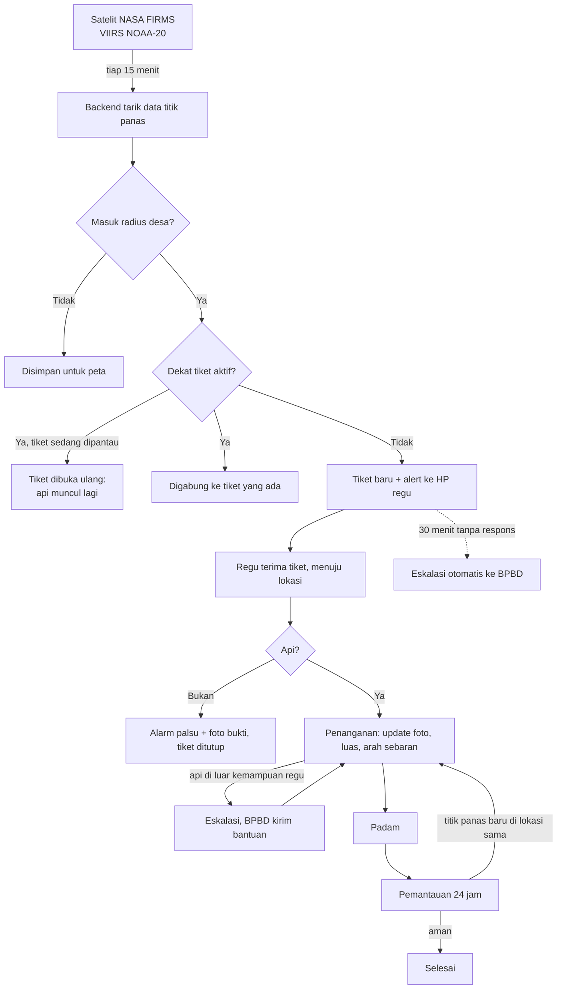

# Fire Respond

Sistem peringatan dini dan penanganan kebakaran hutan dan lahan (karhutla) yang menghubungkan data titik panas satelit langsung ke regu pemadam desa.

**JOINTS UGM 2026 · Hackathon · Tema Sustainability**
Subtema: *Masyarakat sekitar hutan dan lahan gambut yang terdampak kebakaran dan deforestasi, sehingga sulit memantau titik api dan alih fungsi lahan sejak dini.*

## Coba langsung

| | Link | Akun |
|---|---|---|
| Dashboard BPBD (web) | https://fire-respond-production.up.railway.app | `admin` / `firerespond123` |
| Aplikasi regu MPA (Android) | https://github.com/Fire-Respond/fire-respond/releases/tag/v1.0 | `regu_a` / `firerespond123` |

Data titik panas di demo memakai **mode replay** (data satelit asli NASA FIRMS tanggal 21 Agustus 2026), karena saat ini di luar puncak musim kebakaran.

---

## Masalah

Satelit NASA mendeteksi titik panas di Indonesia beberapa kali sehari, dan datanya sudah ditampilkan di sistem seperti SiPongi. Tetapi data itu berhenti di peta. Titik panas belum tentu api, jadi harus dicek di lapangan oleh Masyarakat Peduli Api (MPA) atau tim BPBD, dan proses dari "titik muncul di peta" sampai "regu tiba di lokasi" masih manual: dipantau, ditelepon, dan dicatat sendiri-sendiri.

Akibatnya, api terlambat dicek saat masih kecil, padahal api di lahan gambut paling mudah dipadamkan di jam-jam pertama.

## Solusi

Fire Respond mengubah setiap titik panas menjadi **tiket penanganan** yang otomatis dikirim ke regu terdekat, lalu dilacak sampai api padam.

- **Aplikasi mobile** untuk regu MPA di lapangan: menerima alert, menuju lokasi, melapor dengan foto dan GPS, meminta bantuan.
- **Dashboard web** untuk BPBD di kantor: memantau peta titik panas dan semua tiket, melihat laporan lapangan, mengirim bantuan.
- **Backend** yang menarik data satelit otomatis, mencocokkan titik panas dengan wilayah desa, dan menjalankan aturan SLA.

> SiPongi adalah peta untuk pemerintah. Fire Respond adalah alat kerja untuk regu yang memegang selang.

## Alur sistem



### Status tiket

| Status | Arti | Diubah oleh |
|---|---|---|
| `Baru` | Titik panas masuk radius desa, belum direspons | Sistem |
| `MenujuLokasi` | Regu menerima tiket dan berangkat | Regu |
| `Dicek` | Regu tiba di lokasi | Regu |
| `AlarmPalsu` | Bukan api (wajib foto), tiket ditutup | Regu |
| `Penanganan` | Api dikonfirmasi (wajib foto), sedang dipadamkan | Regu / sistem (api muncul lagi) |
| `Pemantauan` | Api padam (wajib foto), dipantau 24 jam | Regu |
| `Selesai` | Tiket ditutup | Regu / sistem (setelah 24 jam) |

Eskalasi bukan status, melainkan penanda yang bisa muncul di status mana pun: dipicu regu ("Minta bantuan BPBD") atau otomatis oleh sistem kalau tiket `Baru` tidak direspons dalam 30 menit.

## Fitur utama

**Backend**
- Penarik data NASA FIRMS otomatis tiap 15 menit, dengan filter tingkat kepercayaan dan penghapusan duplikat.
- Pencocokan titik panas ke desa terdekat dengan rumus haversine, sesuai radius tiap desa.
- Penggabungan titik panas yang bergerombol (radius 3 km) supaya satu kebakaran tidak jadi puluhan tiket.
- Aturan SLA: eskalasi otomatis 30 menit, penutupan otomatis setelah 24 jam pemantauan.
- **Buka ulang otomatis**: titik panas baru di lokasi tiket yang sedang dipantau membuka tiket itu lagi. Ini penting untuk api gambut yang bisa menyala kembali dari bawah permukaan.
- **Mode replay**: memutar ulang data satelit tanggal tertentu untuk demo dan pelatihan di luar musim kebakaran.
- Pencarian nama desa otomatis dari koordinat (OpenStreetMap Nominatim).

**Aplikasi mobile regu**
- Alert dengan suara dan getar saat ada titik panas baru di wilayah regu.
- Peta lokasi titik panas, area deteksi satelit, dan tombol navigasi Google Maps.
- Alur laporan sesuai status: terima tiket, konfirmasi api atau alarm palsu, update kondisi, padam, cek ulang.
- Foto langsung dari kamera (bukan galeri) dengan lokasi GPS saat foto diambil.
- Tombol minta bantuan BPBD dan notifikasi saat bantuan dikirim.

**Dashboard web BPBD**
- Peta titik panas, wilayah desa, dan tiket berwarna sesuai status, dengan pilihan citra satelit.
- Ringkasan: tiket aktif, belum direspons, eskalasi aktif, rata-rata waktu respons, rasio alarm palsu, total luas terbakar.
- Daftar tiket dengan prioritas: yang dieskalasi dan belum dibantu selalu di atas.
- Riwayat laporan lapangan lengkap dengan foto.
- **Validasi lokasi foto**: foto yang diambil lebih dari 2 km dari titik panas ditandai "perlu dicek".
- Tombol kirim bantuan, mode replay, dan refresh otomatis tiap 15 detik.

## Arsitektur

```
┌─────────────────────┐      ┌──────────────────────────────┐      ┌──────────────────┐
│ App mobile regu     │      │ Backend ASP.NET Core 9       │      │ Supabase         │
│ React Native (Expo) │◄────►│ - REST API                   │◄────►│ PostgreSQL       │
└─────────────────────┘ HTTP │ - Dashboard web (Razor +     │  EF  └──────────────────┘
┌─────────────────────┐      │   Leaflet)                   │ Core
│ Dashboard web BPBD  │◄────►│ - FirmsWorker (background)   │◄──── NASA FIRMS API (CSV)
│ (browser)           │      │ - Simpan foto (wwwroot)      │◄──── OpenStreetMap Nominatim
└─────────────────────┘      └──────────────────────────────┘
```

| Bagian | Teknologi |
|---|---|
| Backend & API | ASP.NET Core 9, Entity Framework Core 9 |
| Database | PostgreSQL di Supabase (Npgsql) |
| Penarik data | `BackgroundService` .NET + CsvHelper |
| Dashboard web | Razor view, JavaScript, Leaflet 1.9, OpenStreetMap / Esri World Imagery |
| Mobile | React Native, Expo SDK 57, react-native-maps, expo-location, expo-image-picker, expo-notifications |
| Sumber data | NASA FIRMS (VIIRS NOAA-20 NRT), OpenStreetMap Nominatim |

## Struktur repository

```
fire-respond/
├── backend/FireRespond/
│   ├── Controllers/
│   │   ├── Api/                 # AuthController, TiketController, DashboardController, Admin*
│   │   └── HomeController.cs    # halaman dashboard dan login
│   ├── Data/                    # AppDbContext, SeedData
│   ├── Migrations/
│   ├── Models/Entities.cs
│   ├── Services/                # FirmsService, FirmsWorker, Geo, TokenService, NominatimService
│   ├── Views/Home/              # Index (dashboard), Login
│   └── wwwroot/                 # css, js dashboard, uploads (foto)
└── mobile/regu-mpa/
    ├── App.js                   # navigasi dan polling notifikasi
    └── src/                     # api, config, screens, ui
```

## Cara menjalankan

### Prasyarat
- .NET SDK 9
- Node.js 20 atau lebih baru
- Akun [Supabase](https://supabase.com) (gratis) dan MAP_KEY [NASA FIRMS](https://firms.modaps.eosdis.nasa.gov/api/map_key/) (gratis)
- Aplikasi **Expo Go** versi terbaru di HP Android

### 1. Database (Supabase)
1. Buat project baru, region **Southeast Asia (Singapore)**.
2. Klik **Connect**, pilih tab **Direct**, metode **Session pooler**, tipe **.NET**. Salin connection string-nya.

### 2. Backend + dashboard
Buat file `backend/FireRespond/appsettings.Development.json` (file ini tidak ikut di repo karena berisi rahasia):

```json
{
  "ConnectionStrings": {
    "Default": "Host=...pooler.supabase.com;Port=5432;Database=postgres;Username=postgres.xxxx;Password=...;SSL Mode=Require;Trust Server Certificate=true"
  },
  "Firms": {
    "MapKey": "ISI_MAP_KEY_FIRMS",
    "Source": "VIIRS_NOAA20_NRT",
    "Area": "110.7,-3.6,116.0,0.8",
    "IntervalMenit": 15,
    "SlaMenit": 30,
    "PemantauanJam": 24,
    "RadiusBukaUlangKm": 3.0
  },
  "Logging": {
    "LogLevel": {
      "Default": "Information",
      "Microsoft.AspNetCore": "Warning",
      "Microsoft.EntityFrameworkCore.Database.Command": "Warning",
      "System.Net.Http.HttpClient": "Warning"
    }
  }
}
```

Lalu jalankan:

```bash
cd backend/FireRespond
dotnet tool install --global dotnet-ef --version 9.0.4   # sekali saja
dotnet run
```

Saat pertama jalan, tabel dan data awal (3 desa, 3 regu, 4 akun) dibuat otomatis. Buka `http://localhost:5139` untuk dashboard.

**Isi data demo** (di luar musim kebakaran titik panas hari ini biasanya sepi): di dashboard, pilih tanggal di **Mode replay** (misalnya `2026-08-21`) lalu klik **Putar data**. Atau lewat terminal:

```bash
curl -X POST "http://localhost:5139/api/admin/firms/replay?tanggal=2026-08-21"
```

### 3. Aplikasi mobile
```bash
cd mobile/regu-mpa
npm install
npx expo start                  # scan QR dengan Expo Go
```

Secara bawaan aplikasi terhubung ke server demo di Railway (`src/config.js`). Untuk memakai backend lokal, jalankan backend dengan `dotnet run --urls http://0.0.0.0:5139`, lalu di layar login **tekan lama logo** untuk membuka pengaturan server dan isi `http://<IP-laptop>:5139` (HP dan laptop di WiFi yang sama).

### 4. Deploy
- **Backend + dashboard**: Railway, dari `backend/FireRespond/Dockerfile` (Root Directory `backend/FireRespond`). Rahasia diisi lewat environment variable `ConnectionStrings__Default` dan `Firms__MapKey`, tidak pernah di repo.
- **APK Android**: `npx eas-cli build -p android --profile preview` di folder `mobile/regu-mpa`.

### Akun demo

| Username | Peran | Password |
|---|---|---|
| `admin` | Admin BPBD (dashboard web) | `firerespond123` |
| `regu_a` | Regu MPA A | `firerespond123` |
| `regu_b` | Regu MPA B | `firerespond123` |
| `regu_c` | Regu MPA C | `firerespond123` |

## API

Semua endpoint tiket memakai header `Authorization: Bearer <token>`. Waktu dikirim dalam UTC.

| Method | Endpoint | Keterangan |
|---|---|---|
| POST | `/api/auth/login` | `{ username, password }`, mengembalikan token |
| GET | `/api/auth/saya` | Cek token |
| GET | `/api/tiket` | Tiket aktif (regu: miliknya, admin: semua) |
| GET | `/api/tiket/{id}` | Detail + riwayat update |
| POST | `/api/tiket/{id}/terima` | `Baru` → `MenujuLokasi` |
| POST | `/api/tiket/{id}/update` | Multipart: `status`, `foto`, `lat`, `lon`, `luasHa`, `ukuranApi`, `arahSebaran`, `catatan` |
| POST | `/api/tiket/{id}/eskalasi` | Regu minta bantuan BPBD |
| POST | `/api/tiket/{id}/bantuan` | Admin menandai bantuan dikirim |
| GET | `/api/dashboard/ringkasan` | Angka untuk kartu ringkasan |
| GET | `/api/dashboard/peta?jam=48` | Titik panas, desa, tiket aktif |
| POST | `/api/admin/firms/tarik` | Tarik data satelit sekarang |
| POST | `/api/admin/firms/replay?tanggal=YYYY-MM-DD` | Putar ulang data satelit tanggal tertentu |
| POST | `/api/admin/desa/isi-nama` | Isi nama desa otomatis dari koordinat |

## Keterbatasan prototipe dan rencana pengembangan

| Sekarang (prototipe) | Rencana |
|---|---|
| Alert lewat polling saat aplikasi terbuka | Push notification via Firebase Cloud Messaging, plus SMS untuk HP tanpa internet |
| Laporan butuh sinyal | Mode offline: laporan disimpan di HP dan dikirim saat ada sinyal |
| Satu sumber satelit (VIIRS NOAA-20) | Gabungan VIIRS SNPP/NOAA-21 dan MODIS untuk deteksi lebih sering |
| Endpoint admin belum dikunci login | Otorisasi berbasis peran untuk semua endpoint admin |
| Foto disimpan di server | Penyimpanan objek (Supabase Storage) |
| Data alarm palsu baru dicatat | Model yang belajar dari konfirmasi regu untuk menurunkan prioritas lokasi yang sering alarm palsu (misalnya cerobong pabrik) |
| Wilayah desa berupa titik + radius | Batas desa sebenarnya (poligon) dan peta lahan gambut |

## Sumber data

- NASA FIRMS, Fire Information for Resource Management System: https://firms.modaps.eosdis.nasa.gov/
- OpenStreetMap Nominatim (reverse geocoding): https://nominatim.org/
- SiPongi+, Kementerian Kehutanan: https://sipongi.menlhk.go.id/

## Penggunaan AI

Sesuai ketentuan lomba, penggunaan AI dicantumkan secara terbuka. Detail lengkap ada di pitch deck dan Bab VII proposal.

| Tools | Peran dalam pengembangan |
|---|---|
| Claude (Anthropic) | Brainstorming ide dan validasi masalah, penyusunan proses bisnis, pembuatan draf kode backend, dashboard, dan aplikasi mobile, debugging konfigurasi (Supabase, versi paket, deploy), penyusunan README dan pitch deck, peninjauan struktur proposal |
| Google Gemini | Alternatif nama produk, konsep logo dan palet warna, draf dan penyuntingan bahasa proposal |


## Tim

**Tim Lupa Cara Ngoding**, Politeknik Astra

| Nama | Peran |
|---|---|
| _Aryasatya Jovan Lateef_ | Backend |
| _Yuwan Yoga Pratama_ | Mobile |
| _Deni Handika Shaputra_ | Web dashboard |
| _Alvaro Naufal Saksono_ | Produk, proposal, pitch |
